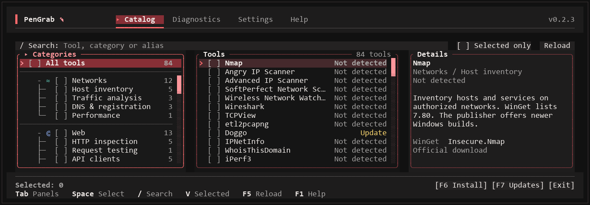

  

# PenGrab

**Un catálogo portátil de 283 herramientas de seguridad y diagnóstico para la terminal de Windows.** Explora por categorías, comprueba qué detecta WinGet y revisa las instalaciones y actualizaciones seleccionadas.

[Descargar](https://github.com/saturnus25/PenGrab/releases/latest) · [Inicio rápido](#inicio-rápido) · [Controles](#controles) · [Automatización](docs/NonInteractive.md) · [Incidencias](https://github.com/saturnus25/PenGrab/issues) · [English](README.md)

> [!NOTE]
> **Desarrollo asistido por IA.** Se utilizó IA para ayudar a implementar, probar y documentar PenGrab. El responsable del proyecto revisa los cambios y decide qué se publica.

*Captura del catálogo con inventario de paquetes simulado.*

## Inicio rápido

### 📦 ZIP portátil

1. Descarga el **ZIP para Windows x64** de [GitHub Releases](https://github.com/saturnus25/PenGrab/releases/latest).
2. Extrae la carpeta **PenGrab** completa en una ubicación con permisos de escritura y abre **PenGrab.bat**. Si quieres mover la aplicación, mueve la carpeta entera para conservar el catálogo y tus ajustes.
3. Pulsa **F4** y cambia el idioma a **Español**. Usa **/** para buscar, **F3** para abrir el diagnóstico o **F1** para consultar la ayuda.

El ZIP incluye el ejecutable y el catálogo. Puedes explorar las herramientas sin WinGet. WinGet sirve para consultar el inventario y gestionar paquetes.

### ⚡ Instalar desde PowerShell

Ejecuta este comando en **Windows PowerShell 5.1** o **PowerShell 7** para instalar PenGrab y abrirlo después de confirmar.

~~~powershell
& ([ScriptBlock]::Create((irm -UseBasicParsing 'https://github.com/saturnus25/PenGrab/releases/latest/download/install.ps1')))
~~~

La ventana de instalación muestra la carpeta recomendada, `%LOCALAPPDATA%\Programs\PenGrab`. Pulsa **Install** para usarla o **Browse** para elegir o crear otra carpeta. **Cancel** cierra el instalador. Usa `-InstallPath` para indicar una ruta absoluta o `-ChoosePath` para abrir directamente el selector de carpetas.

### 🪄 Abrir una sesión temporal

~~~powershell
& ([ScriptBlock]::Create((irm -UseBasicParsing 'https://github.com/saturnus25/PenGrab/releases/latest/download/bootstrap.ps1')))
~~~

El bootstrap se ejecuta en memoria, extrae los archivos de la aplicación a una carpeta temporal y los elimina al cerrar la sesión.

Los dos scripts comprueban la firma del manifiesto, el tamaño y el SHA-256 del ZIP. Puedes revisar los scripts en [GitHub Releases](https://github.com/saturnus25/PenGrab/releases/latest) antes de ejecutarlos. Para usar un paquete firmado local, pasa `-ReleaseDirectory` al script descargado.

## Controles

| Acción | Atajo |
| :--- | :--- |
| Cambiar de panel y moverse por la lista | `Tab` y flechas |
| Plegar o expandir una rama | `←` y `→` |
| Marcar una herramienta o toda una rama | `Espacio` o clic en su casilla |
| Buscar por nombre, alias o ID de WinGet | `/` o `Ctrl+F` |
| Saltar al resultado o filtrar la lista | `Enter` o `Tab` dentro de la búsqueda |
| Revisar las instalaciones o actualizaciones seleccionadas | `F6` o `F7` |
| Revisar una actualización de PenGrab | `F8` en Diagnóstico |

El control **Todas las herramientas** permanece encima del árbol. Una rama marcada incluye también sus descendientes ocultos por un filtro. En pantalla compacta, **Enter** abre los detalles de la herramienta.

Encuentra **Everything** en **Sistema Windows → Búsqueda de archivos** o busca `voidtools`. En sus detalles aparecen el ID de WinGet y la página de descarga del proveedor.

**Configuración** permite comparar el valor actual con la alternativa para idioma, tema, ratón, movimiento reducido, árbol de categorías y estados de paquetes. Usa **Enter** o haz clic en el valor para aplicar el cambio. **Diagnóstico** comprueba en paralelo el inventario y las actualizaciones que WinGet puede identificar.

## 🤖 Automatización y compilación

~~~powershell
.\PenGrab.bat --catalog-json
.\PenGrab.bat --diagnostics
~~~

Consulta el [contrato no interactivo](docs/NonInteractive.md) para seleccionar IDs, simular operaciones y leer los resultados en JSON. La [documentación en inglés](README.md#build-from-source) explica cómo compilar con Rust y preparar el paquete de Windows.

## 📜 Licencia

PenGrab se distribuye bajo la [licencia MIT](LICENSE). Las licencias y avisos de las dependencias están en [Third-party notices](THIRD-PARTY-NOTICES.md).
