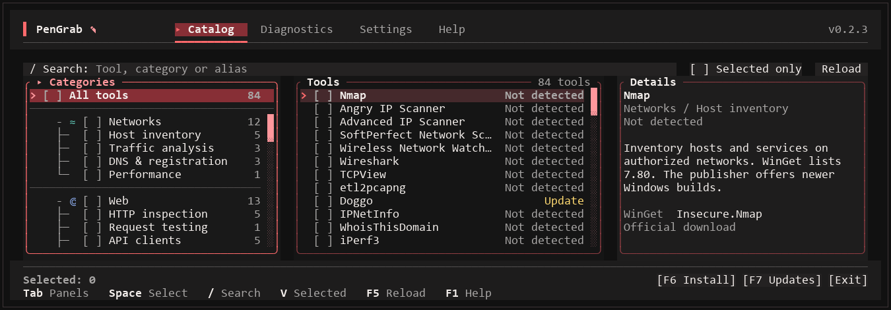
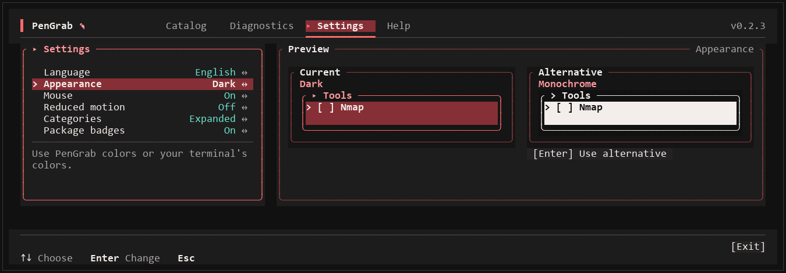

  

# PenGrab

**A portable Windows terminal catalog for security and diagnostics tools.** Browse by category, check what WinGet detects, and review selected installs and updates from one screen.

[Download](https://github.com/saturnus25/PenGrab/releases/latest) · [Quick start](#quick-start) · [Controls](#controls) · [Automation](docs/NonInteractive.md) · [Build](#build-from-source) · [Issues](https://github.com/saturnus25/PenGrab/issues) · [Español](README.es.md)

> [!NOTE]
> **AI-assisted development.** AI was used to help implement, test and document PenGrab. The maintainer reviews changes and decides what to release.

*Catalog preview captured with simulated package inventory.*

## Quick start

### 📦 Portable ZIP

1. Download the **Windows x64 ZIP** from [GitHub Releases](https://github.com/saturnus25/PenGrab/releases/latest).
2. Extract the whole **PenGrab** folder to a writable location and open **PenGrab.bat**. Move the folder as a unit to keep the app, catalog and settings together.
3. Press **/** to search, **F3** for diagnostics, **F4** for settings or **F1** for help.

The portable bundle includes the executable and the catalog. WinGet is optional for browsing and required for its inventory and package operations. The release scripts support **Windows PowerShell 5.1** and **PowerShell 7**.

### ⚡ Install from PowerShell

Run this command in **Windows PowerShell 5.1** or **PowerShell 7** to install PenGrab and open it after confirmation.

~~~powershell
& ([ScriptBlock]::Create((irm -UseBasicParsing 'https://github.com/saturnus25/PenGrab/releases/latest/download/install.ps1')))
~~~

When the installer asks for the folder, enter an absolute path or press **Enter** to use `%LOCALAPPDATA%\Programs\PenGrab`. The installer also accepts `-InstallPath` for an absolute destination or `-ChoosePath` for a folder picker.

### 🪄 Run a temporary session

~~~powershell
& ([ScriptBlock]::Create((irm -UseBasicParsing 'https://github.com/saturnus25/PenGrab/releases/latest/download/bootstrap.ps1')))
~~~

The bootstrap starts from memory, extracts the application files to a temporary directory and removes them when the session ends.

Both scripts verify the manifest signature and the ZIP's size and SHA-256. Review the scripts under [GitHub Releases](https://github.com/saturnus25/PenGrab/releases/latest) before running them. To use a signed bundle from disk, pass `-ReleaseDirectory` to the downloaded script.

## 🧭 What you can do

| 🔎 Browse and search | 📊 Check installed tools |
| :--- | :--- |
| Find tools and categories by name, alias or WinGet ID, including close spellings. Jump directly into a folded branch or filter the current list. | See the installed versions and updates WinGet can match. The inventory and update lookups run in parallel. |
| **📋 Review package changes** | **🎛️ Adapt the interface** |
| Select individual tools or an entire branch. Review install and update queues before applying them. Open a publisher link from Details when available. | Use keyboard or mouse, switch between English and Spanish, and compare settings before applying them. Panels adapt as you resize the terminal. |

### Controls

| Action | Shortcut |
| :--- | :--- |
| Browse the category tree and the tool list | `Tab` switches panels. Arrow keys move the cursor. `←` and `→` fold and expand the tree. |
| Mark a tool or a branch | `Space` or click its checkbox |
| Open the selected tool's details | `Enter` in the tool list |
| Search, jump or filter | `/` or `Ctrl+F` opens search. `Enter` jumps. `Tab` applies the filter. `Esc` cancels. |
| Show selected tools or refresh the catalog | `V` or `F5` |
| Review selected installs or package updates | `F6` or `F7` |
| Open Diagnostics, Settings or Help | `F3`, `F4` or `F1` |
| Review a detected PenGrab update | `F8` in Diagnostics |

**All tools** stays pinned above the category tree. A branch checkbox includes descendants hidden by filters. `[x]` means fully selected and `[-]` means partially selected. In wide terminals, Details stays beside the catalog. At compact sizes, open it from the tool list.

### 🎛️ Settings

Use **F4** to change the language, appearance, mouse behavior, search highlight motion, category layout or package badges. Move the focus to compare the current value and the alternative. Press **Enter** or click the value to apply it. The comparison moves below the settings on narrower terminals when space allows.

## 📦 Packages and updates

**Diagnostics** reports what WinGet can match to the catalog. A manually installed tool may appear as **Not detected**. **WinGet ID pending** means the catalog has yet to confirm its package ID. Some entries provide a publisher download or a project page.

The package queue runs one operation at a time, checks the resulting version where available and can stop between packages. Its latest result is written to `config/last-operation.json` in a writable portable folder. PenGrab can also check for signed application updates in Diagnostics. The update check is cached for at least 24 hours. Applying an application update preserves preferences and keeps the previous app directory for recovery.

### 🗂️ Extend the catalog

1. Add a category and its children in [data/categories.json](data/categories.json). Use a stable `id` and an English label. Spanish falls back to English if a label is absent.
2. Add a tool in [data/tools.json](data/tools.json). Give it a unique `id` and the exact category ID. Use `wingetId: null` while a package ID is unconfirmed.
3. Set `aliases` for established abbreviations and alternate names. Use `publisherDownload` or `publisherProject` for the publisher's HTTPS page.
4. Press `F5` to reload. PenGrab keeps selections by ID and retains the previous catalog if the new data fails validation.

A category can set `symbol` to one printable ASCII character and `icon` to a single-cell glyph with a `teal`, `blue` or `gold` accent. Monochrome uses the ASCII fallback. The catalog references [Kali Tools](https://www.kali.org/tools/) and WinGet entries from the [WinGet package registry](https://github.com/microsoft/winget-pkgs).

## 🤖 Automation

Use text output to inspect the catalog or diagnostics. Windows PowerShell 5.1 and PowerShell 7 can both call the launcher.

~~~powershell
.\PenGrab.bat --catalog
.\PenGrab.bat --catalog-json
.\PenGrab.bat --diagnostics
~~~

The executable also accepts `--lang es`, `--no-color` and `--no-mouse`. For unattended selections, previews and exit codes, see the [non-interactive contract](docs/NonInteractive.md).

## Build from source

Use stable Rust with the Windows MSVC toolchain. The Windows SDK resource compiler embeds the application icon.

~~~powershell
cargo build --release --locked
.\PenGrab.bat
cargo test --release --locked
~~~

[Package-Portable.ps1](Package-Portable.ps1) builds the Windows ZIP. [Package-Release.ps1](Package-Release.ps1) creates the signed manifest, installer and bootstrap. Release signing uses a maintainer key held outside version control. The legacy PowerShell prototype is available through `PenGrab.ps1`.

See [AGENTS.md](AGENTS.md) for terminal design and verification conventions.

## 📜 License

PenGrab is distributed under the [MIT License](LICENSE). Dependency licenses and copyright notices are in [Third-party notices](THIRD-PARTY-NOTICES.md).
